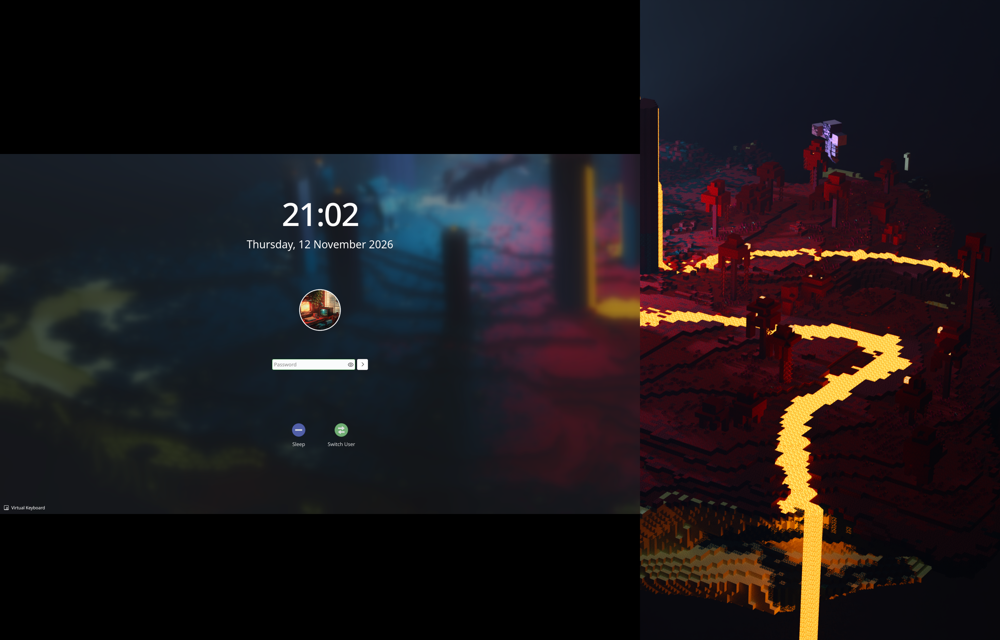
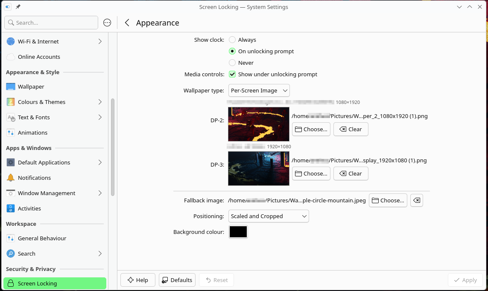

# Per-Screen Lock Screen Wallpaper for KDE Plasma

A different lock screen wallpaper on every monitor in KDE Plasma 6.

Plasma lets you give each monitor its own **desktop** wallpaper, but the **lock screen** has a single wallpaper setting that it shows on every screen. This is a long-standing request (KDE bugs [488890](https://bugs.kde.org/show_bug.cgi?id=488890), [481583](https://bugs.kde.org/show_bug.cgi?id=481583), [406774](https://bugs.kde.org/show_bug.cgi?id=406774)).

This repo provides a small wallpaper plugin, **Per-Screen Image**. You select it as the lock screen's wallpaper type, and it shows a different image on each monitor based on which port the monitor is plugged into (`DP-1`, `HDMI-A-1`, …). It doesn't patch kscreenlocker or need root.


<sub>Wallpaper: Minecraft artwork via [Wallhaven](https://whvn.cc/l31vz2), see [Credits](#credits).</sub>

## Requirements

- KDE Plasma 6 (tested on 6.8, Wayland)
- `kpackagetool6` (part of Plasma)

## Install

```bash
git clone https://github.com/MakrisJr/plasma-perscreen-lock-wallpaper.git
cd plasma-perscreen-lock-wallpaper
./install.sh --enable
```

`--enable` installs the plugin into `~/.local/share/plasma/wallpapers/com.github.makrisjr.perscreenimage/` and sets it as the lock screen wallpaper type. Run `./install.sh` without options to install or update the plugin without changing your lock screen setting.

## Configure

**System Settings → Screen Locking → Appearance**, then set *Wallpaper type* to **Per-Screen Image**.



### Config file

Settings are stored in `~/.config/kscreenlockerrc`:

```ini
[Greeter]
WallpaperPlugin=com.github.makrisjr.perscreenimage

[Greeter][Wallpaper][com.github.makrisjr.perscreenimage][General]
ScreenImages=DP-3=file:///home/me/Pictures/landscape.png,DP-2=file:///home/me/Pictures/portrait.png
FallbackImage=file:///home/me/Pictures/default.jpg
FillMode=2
Color=0,0,0
```

To list your monitors' connector names, run:

```bash
kscreen-doctor -o
```

You can also set the images from a script:

```bash
kwriteconfig6 --file kscreenlockerrc --group Greeter --group Wallpaper \
  --group com.github.makrisjr.perscreenimage --group General \
  --key ScreenImages "DP-3=file:///path/a.png,DP-2=file:///path/b.png"
```

## Test without locking

```bash
/usr/lib/kscreenlocker_greet --testing
```

This opens the lock screen UI without actually locking your session. Close it by entering your password, or run `pkill -f 'kscreenlocker_greet --testing'`. You can also just lock with <kbd>Meta</kbd>+<kbd>L</kbd>.

## How it works

The lock screen draws one wallpaper per monitor, but gives each one the same settings. This plugin's [`main.qml`](package/contents/ui/main.qml) reads `Screen.name`, the name of the port the current monitor is on, finds the matching `NAME=url` entry in `ScreenImages`, and uses `FallbackImage` if there is none. Because it's a normal wallpaper plugin, you can also use it as a desktop wallpaper.

## Limitations

- Images are tied to **ports**, not physical monitors. If you plug a monitor into a different port, it shows the fallback image until you choose an image for its new port.
- Static images only, no slideshows or day/night wallpapers.

## Uninstall

```bash
./install.sh --uninstall
```

This switches the lock screen back to the stock *Image* wallpaper type and removes the plugin.

## Packaging

```bash
./install.sh --package   # -> dist/com.github.makrisjr.perscreenimage-<version>.tar.gz
```

The archive can be installed through *Get New Wallpaper Plugins* or uploaded to the KDE Store.

## License

The plugin code is licensed under [GPL-2.0-or-later](LICENSE).

## Credits

The wallpapers in the screenshots are made from a piece of Minecraft artwork, [*The Battle of the End has begun*](https://www.reddit.com/r/Minecraft/comments/vfgjo7/the_battle_of_the_end_has_begun_4k/), originally posted on r/Minecraft. Found via [Wallhaven](https://whvn.cc/l31vz2). The image belongs to its original creator, and Minecraft is a trademark of Mojang Studios. The wallpapers are **not** part of this repository's GPL license and are only shown to demonstrate the plugin.
